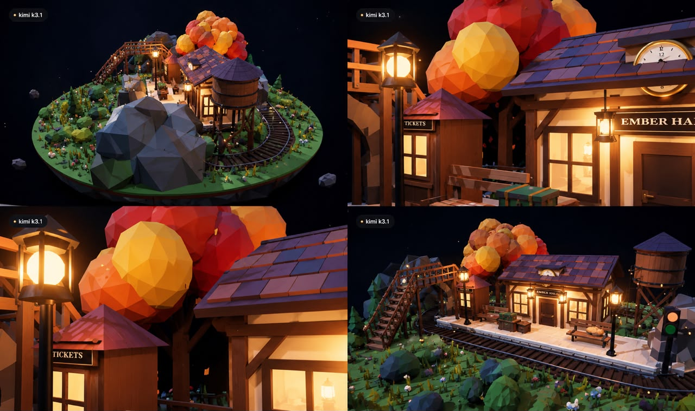
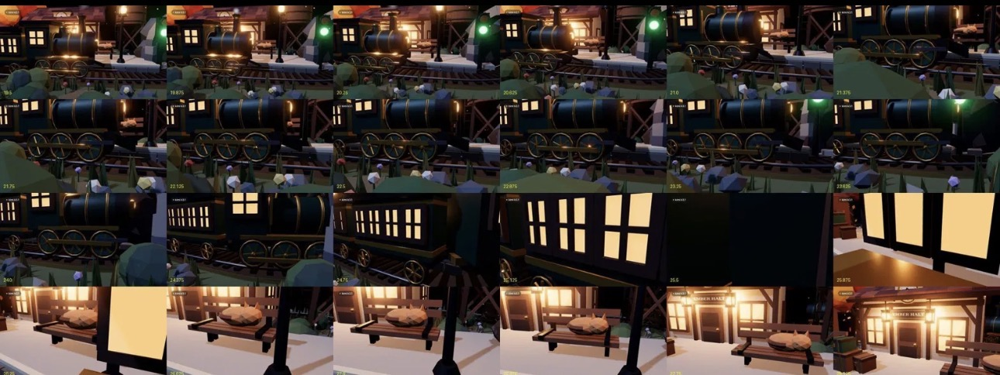

# train station

a real-time 3d floating island diorama. single html file, three.js from a cdn, everything procedural. no external models or textures.

open `index.html` in a browser.

built with kimi k3.1.

---

## preview

the island from four angles. a round chunk of earth floating in black void, low poly rock underside, autumn tree in orange and gold. the station building reads EMBER HALT with a clock above the door and warm light spilling from the windows. street lamps, a water tower, a wooden footbridge over the tracks, and the signal light at the platform edge.

frames from the arrival loop. the locomotive in deep green and gold pulls in past the signal, carriage windows glowing, then settles at the platform where the cat is asleep on the bench. it waits four seconds before pulling away into the far tunnel.

---

## the prompt

build a real-time 3d floating island diorama in a single html file using three.js from a cdn. no external models or textures, everything procedural and handcrafted in code.

**scene**
- a round floating chunk of earth hovering in a pure black void, with a rocky low poly underside, dangling roots and small rock fragments slowly orbiting around it
- the top is a cozy countryside railway station at dusk
- a small vintage station building with a sloped tiled roof, wooden beams, a clock above the door, warm glowing windows and two hanging lanterns by the entrance
- a raised stone platform with wooden benches, a bench with a sleeping cat, luggage trunks, a ticket booth and old street lamps
- a railway track that runs across the island, curves around the edge and disappears into small tunnels carved into rock on both sides so the train loops forever
- a red signal light, a water tower and a small wooden footbridge over the tracks
- a big autumn tree with orange and gold leaves next to the station, slowly dropping leaves that drift down
- grass tufts, bushes, flowers and stones scattered naturally across the island

**the train**
- a steam locomotive in deep green and gold with two passenger carriages that have glowing windows
- it exits one tunnel, slows down, stops at the platform for 4 seconds, then pulls away and enters the other tunnel
- wheels spin and connecting rods move in sync with speed
- puffs of white steam rise from the chimney and fade, thicker when accelerating
- the signal turns green before it departs and red after it passes
- the station lamps flicker on slightly brighter when the train arrives

**look**
- stylized low poly with soft detail, like a premium miniature diorama
- warm interior light against cool blue dusk shadows, soft shadows and gentle bloom on lights
- fireflies floating around the island
- the whole island bobs very slowly up and down

**camera and ui**
- orbit controls with smooth damping, zoom limits so you can't go inside the island
- slow auto rotate when idle
- a small "real-time diorama" label in the top right
- a minimal glass style control bar at the bottom center with: reset camera, pause/play, capture (saves a png), fullscreen, and an eye toggle that hides the ui
- clicking the train makes it blow its whistle with a web audio sound

**performance**
- keep it at 60fps, reuse geometry and materials, use instancing for grass and leaves

deliver the complete working code in one file, no placeholders or todos.
